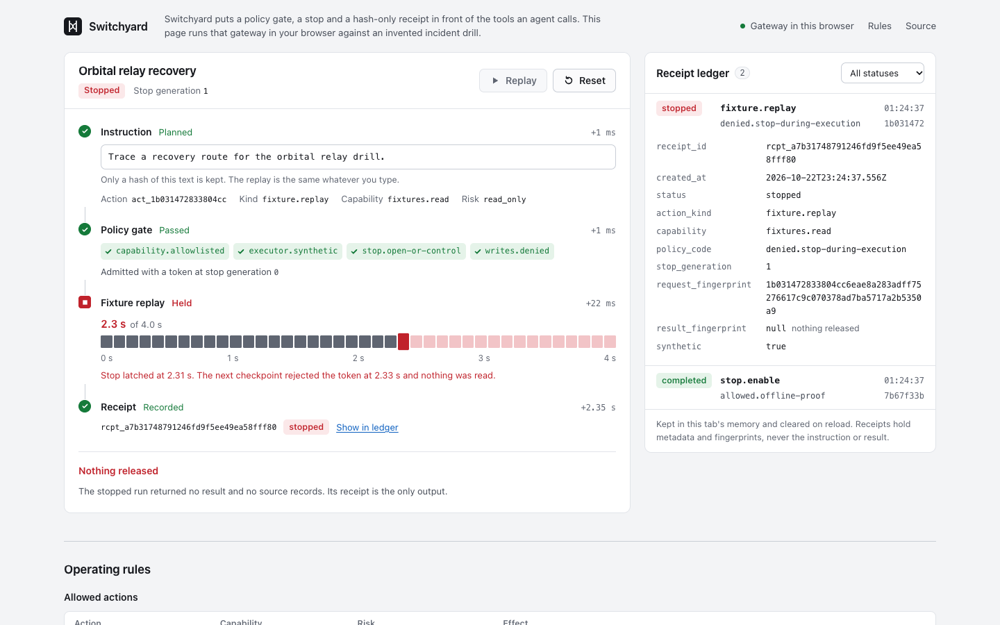
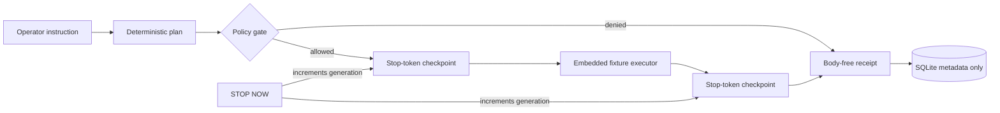

# Switchyard

An operator console where every action crosses a policy gate, any run can be stopped mid-flight, and the record keeps fingerprints instead of commands.

**Live demo: <https://switchyard-phi.vercel.app>**. Press *Replay incident*, then *Stop* within four seconds.



## What it does

Switchyard replays one versioned incident fixture, an orbital relay recovery drill, through a deny-by-default gate. The replay is paced on purpose so you can stop it. A completed run releases the captured evidence. A stopped run releases nothing except its receipt. Reset needs an explicit acknowledgement and is recorded too.

It is an offline proof, not an assistant with imaginary integrations:

| Capability | Status | Evidence |
| --- | --- | --- |
| Deterministic incident replay | Implemented | Versioned JSON fixture and repeatability tests |
| Deny-by-default policy gate | Implemented | Exact capability/risk allowlist and negative tests |
| Stop during execution | Implemented | Generation-token invalidation and async concurrency test |
| Audited stop and reset | Implemented | Separate control routes and receipt rows |
| Body-free receipt ledger | Implemented | Reduced SQLite schema and byte-level privacy test |
| Live web, email, files, repos, or messaging | **Not implemented** | No provider or adapter code ships |
| External write actions | **Denied** | No write capability exists in proof mode |

## How it works



Every execution and control mutation enters `ActionGateway`. A stop increments a generation counter, and the executor checks its token against it at every checkpoint, so a run already past the gate is still held. Read-only health, state and receipt endpoints do not create receipts. The optional receipt annotation changes the request fingerprint, not the fixture result.

### The hosted demo

The Vercel build sets `VITE_DEMO_MODE=true`. The console then talks to `frontend/src/lib/engine.ts`, a TypeScript port of the policy gate, stop controller, paced executor and receipt ledger, instead of the FastAPI server. Both read the same fixture file, and fingerprints match the Python implementation byte for byte; the frontend and backend suites assert the same golden hashes. In this mode the route shows each stage live (planned, gated, replaying).

Limits of the demo: receipts live in the browser tab and clear on reload, there is no SQLite store, and nothing leaves the page. Run it locally for the full control plane.

## Run locally

Requirements: Python 3.12+, Node.js 24+, and npm 10+.

```bash
python -m venv .venv
.venv/bin/python -m pip install -r backend/requirements-dev.txt
cd frontend && npm ci && cd ..
```

Start both processes:

```bash
./scripts/dev.sh
```

Open <http://127.0.0.1:5173>. No `.env`, account, token, or network provider is required.

Or use the container profile, which publishes loopback-only ports:

```bash
docker compose up --build
```

Then open <http://127.0.0.1:3000>.

To run the browser-only demo without Python:

```bash
cd frontend && npm ci && VITE_DEMO_MODE=true npm run dev
```

## Verify it

```bash
./scripts/check.sh
```

The check runs the backend suite, Python dependency audit, frontend response-contract tests, typecheck/build/audit, and a high-signal secret scan.

## API surface

| Method | Path | Purpose |
| --- | --- | --- |
| `GET` | `/health` | Liveness and honest runtime mode |
| `GET` | `/api/state` | Stop generation, allowed capabilities, limitations |
| `GET` | `/api/receipts` | Recent metadata-only receipts |
| `POST` | `/api/actions` | Route the embedded fixture through the boundary |
| `POST` | `/api/stop` | Latch stop and invalidate issued tokens |
| `POST` | `/api/stop/reset` | Explicitly acknowledge and reset stop |

The server binds to `127.0.0.1` by default. CORS is an exact, non-credentialed loopback allowlist. These are safeguards, not authentication; read [SECURITY.md](SECURITY.md) before changing the network boundary.

## Project map

- `backend/app/execution.py`: the only execution/control mutation boundary
- `backend/app/policy.py`: compact policy allowlist
- `backend/app/stop.py`: generation-token stop controller
- `backend/app/storage.py`: metadata-only receipt store
- `backend/app/demo_data/`: versioned deterministic evidence
- `frontend/`: responsive React dispatch console
- `ARCH.md`: invariants and extension contract
- `SECURITY.md`: threat model, mitigations, and known risks
- `RUN.md`: operator runbook

Licensed under the [MIT License](LICENSE).
