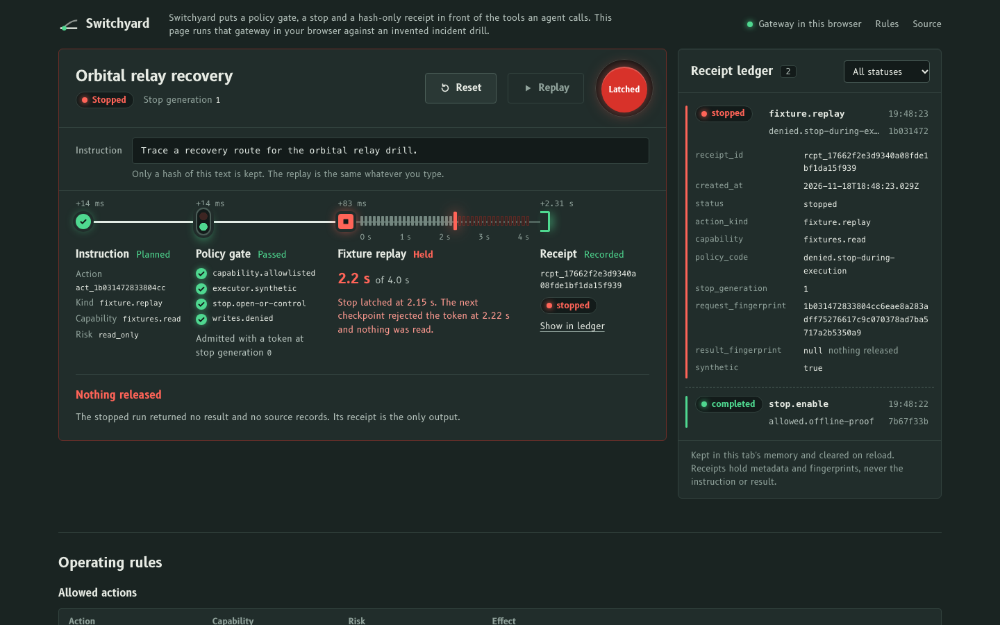

# Switchyard

Switchyard puts a policy gate, a stop and a hash-only receipt in front of the tools an agent calls. [`guard/`](guard/) is the Python package that does it for your own functions, and the console is a browser demo of the same pattern.



## Try it

Open <https://switchyard-phi.vercel.app>, press Replay, then press Stop before the four-second replay window runs out. The run halts at its next 100 ms checkpoint, releases nothing and leaves a receipt in the ledger. The drill it replays, an orbital relay recovery, is invented.

## Gate a tool

```python
from switchyard_guard import Guard, Policy

guard = Guard(Policy({"fs.read": "read"}))


@guard.gated("fs.read", "read")
def read_file(path: str) -> str:
    return open(path).read()
```

A call to a capability you haven't granted raises `Denied` before the function runs. `guard.stop()` ends running calls at their next checkpoint or await, and each call writes a receipt holding fingerprints of its arguments and result, never the values. [guard/README.md](guard/README.md) covers rules, budgets, async tools and the tests behind each guarantee.

## Run it locally

You need Python 3.12 or newer, Node 24 and npm 10.

```bash
python -m venv .venv
.venv/bin/python -m pip install -r backend/requirements-dev.txt -e "guard[test]"
(cd frontend && npm ci)
./scripts/dev.sh
```

Then open <http://127.0.0.1:5173>. No account, token or `.env` is needed. `docker compose up --build` runs the same thing on <http://127.0.0.1:3000>, and `cd frontend && VITE_DEMO_MODE=true npm run dev` runs the browser-only demo without Python.

## What's real

Locally, the console talks to a FastAPI backend. Every replay, stop and reset goes through one gateway in [`backend/app/execution.py`](backend/app/execution.py), a stop increments a generation counter that the paced executor checks every 100 ms, and receipts go to SQLite with no instruction text or result body in the schema.

The hosted demo has no server. It runs [`frontend/src/lib/engine.ts`](frontend/src/lib/engine.ts), a TypeScript port of that gateway, so its receipts live in the tab and clear on reload. Both sides read the same fixture file and check the same golden hashes.

There are no live integrations. The only executor replays an embedded fixture, no write capability exists, and the server binds to `127.0.0.1` with a loopback-only CORS list, which is a safeguard and not authentication. [SECURITY.md](SECURITY.md) has the threat model and [ARCH.md](ARCH.md) the invariants.

## Checks

```bash
./scripts/check.sh
```

This runs the guard, backend and frontend test suites, typecheck and build, both dependency audits and a secret scan. CI runs the same jobs on every pull request.

MIT licensed, see [LICENSE](LICENSE).
